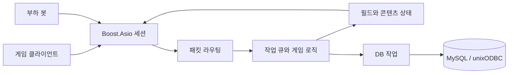

# HARVEN · MMORPG Server

**C++20 · Boost.Asio · MySQL 기반 MMORPG 게임 서버입니다.**

네트워크 세션, 작업 스레드와 메시지 큐, 게임 콘텐츠, DB 저장, 부하 도구 및 규칙 테스트를 함께 담았습니다. Windows IOCP 기반으로 시작한 프로젝트를 Linux·Boost.Asio 기반으로 이식한 개발본의 **포트폴리오용 소스 스냅샷**입니다. 현재 공개 코드의 네트워크 구현은 Boost.Asio입니다.

`C++20` · `Boost.Asio` · `Linux` · `MySQL` · `unixODBC` · `CMake` · `Python`

[클라이언트 소스](https://github.com/minjiyong/HARVEN-CLIENT-Portfolio) · [개발 환경 안내](docs/DEVELOPMENT.md) · [검증 범위](docs/VALIDATION.md)

## 코드 읽기 순서

| 주제 | 대표 구현 |
|---|---|
| 서버 진입과 스레드 | [GameServer.cpp](Server/HARVEN_GameServer/GameServer.cpp), [Worker](Server/HARVEN_GameServer/Worker/) |
| 소켓·세션 수명 | [SocketManager](Libs/Network/SocketManager.cpp), [GameSession](Libs/Network/GameSession.cpp) |
| 동시성과 객체 관리 | [LockFreeStack](Libs/Base/Core/LockFreeStack.h), [ObjectPool](Libs/Base/Core/ObjectPool.h), [SafeMessageQueue](Libs/WorkerThread/SafeMessageQueue.h) |
| 패킷과 작업 라우팅 | [공유 프로토콜](Shared/Protocol/), [Worker/Route](Server/HARVEN_GameServer/Worker/Route/) |
| 게임 콘텐츠 | [Content](Server/HARVEN_GameServer/Content/), [Entity](Server/HARVEN_GameServer/Entity/), [설계 문서](Shared/Document/) |
| DB와 진행 저장 | [DBConnectionPool](Libs/Database/DBConnectionPool.cpp), [스키마·마이그레이션](Shared/Database/mysql/), [ProgressCodec](Server/HARVEN_GameServer/User/ProgressCodec.cpp) |
| 검증과 부하 | [규칙·동시성 테스트](Server/HARVEN_GameServer/tests/), [회귀 스크립트](Tools/Test/), [StressTest](Tools/StressTest/) |

## 처리 흐름



## 빠른 시작: 메모리 DB

Linux 환경과 C++20 컴파일러가 필요합니다. Windows에서는 WSL의 Ubuntu 환경을 사용합니다. 메모리 DB 프리셋은 개인 RDS 접속 정보 없이 서버와 테스트를 살펴보기 위한 경로입니다. 데이터는 프로세스 종료 시 사라집니다.

```bash
git clone https://github.com/minjiyong/HARVEN-SERVER-Portfolio.git
cd HARVEN-SERVER-Portfolio

sudo apt-get update
sudo apt-get install -y g++ cmake ninja-build libboost-dev unixodbc-dev

cmake --preset linux-memory
cmake --build --preset linux-memory --parallel 2
./build/linux-memory/GameServer
```

기본 포트는 4000입니다. 이 공개본은 로컬 서버 소스 검토와 실험을 위한 자료이며, 별도 공개 클라이언트와의 완성 게임 실행을 보장하는 배포본은 아닙니다.

## 테스트

```bash
cmake --build --preset linux-memory --parallel 2 --target \
  ConcurrencyTests BehaviorTreeTests PartyRuleTests LootRuleTests \
  GuildRuleTests AchieveRuleTests ServicePostTests SocialStoreTests

for test in ConcurrencyTests BehaviorTreeTests PartyRuleTests LootRuleTests \
            GuildRuleTests AchieveRuleTests ServicePostTests SocialStoreTests; do
  ./build/linux-memory/Server/HARVEN_GameServer/tests/$test || exit 1
done
```

`linux-asan`, `linux-tsan` 프리셋도 제공합니다. 부하 도구는 `cmake --build --preset linux-memory --target StressTest`로 빌드합니다. 이 저장소에는 측정하지 않은 동시 접속 수나 처리량을 성과 수치로 기재하지 않습니다. 실제 공개 준비 과정의 결과와 제한은 [검증 기록](docs/VALIDATION.md)에 따로 남깁니다.

## 실제 DB 연결

`harven.env.example`을 `harven.env`로 복사하고 본인 환경의 DB 정보와 드라이버를 입력합니다. 실제 설정 파일은 Git에 포함하지 않습니다. 스키마는 [Shared/Database/mysql](Shared/Database/mysql/)에 있습니다.

```bash
cp harven.env.example harven.env
# harven.env 편집 → MySQL/ODBC 환경 준비 후
cmake --preset linux-debug
cmake --build --preset linux-debug --parallel 2
```

Google Sheets 데이터 도구에는 별도 권한과 설정이 필요합니다. `Shared/ToolsConfig/DataTool.json`의 개인 폴더 식별자는 비워 두었으며, 서버 실행에는 이미 제공된 `Bin/GameData/`를 사용할 수 있습니다.

## 공개 범위와 출처

운영 DB 주소·계정·비밀번호, 개인 설정, 기존 Git 이력, 로그·덤프·실행 파일은 포함하지 않았습니다. `docs/DEVELOPMENT.md`에는 원 개발 환경의 설명이 남아 있으므로 공개본의 시작 절차는 이 README를 우선합니다.

외부 라이브러리는 `Libs/ThirdParty/`에 라이선스와 함께 보존했습니다. [공개 범위](docs/PUBLICATION.md) · [소스와 라이선스 안내](SOURCE_NOTICE.md)
